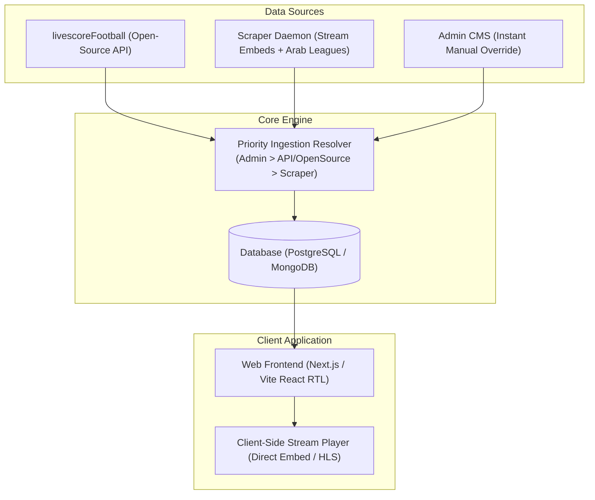
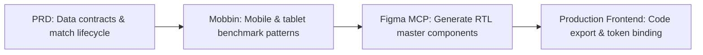

# Design Document: Arabic Football Live Score & Streaming Platform

**Date:** 2026-11-18  
**Status:** Ready for Approval  
**Domain:** Web Application / Sports Media / Real-time Data Platform  

---

## 1. Intent & The "Why"
Build a high-performance, real-time football live score and match streaming portal tailored for Arabic-speaking football fans. The platform captures the clean, intuitive card-based layout popularized by top Arabic football portals (e.g., KoraCity, Draximo, Yalla Shoot) while providing a modern, rich match experience: live score tracking, multi-server video streams, and comprehensive tactical match statistics (lineups on pitch, event timelines, head-to-head stats).

This design also defines the workflow to specify and construct the product using:
1. **Product Requirements Document (PRD):** As the formal specification of data contracts, match lifecycle states, and admin rules.
2. **Mobbin:** To benchmark battle-tested sports interaction flows and responsive mobile/desktop layouts.
3. **Figma MCP Server:** To generate, inspect, and maintain the reusable component design system (RTL-first, dark/light modes).

---

## 2. Goals, Non-Goals, and Anti-Goals

### Goals
* **Familiar, Intuitive UI:** Provide an RTL Arabic interface mirroring the clean card layout of KoraCity / Draximo (Option A).
* **Hybrid Match Detail Center:** Combine a multi-server live stream player at the top with an in-depth stats and lineups center directly below.
* **Resilient Multi-Source Ingestion Engine:** Combine automated scraping (stream links), football data APIs / open backends (e.g., `rezarahiminia/livescoreFootball`), and an admin override panel for 100% uptime during matchdays.
* **Real-Time State Transitions:** Visual distinction between live matches (pulsing red badge `مباشر الآن` with minute ticker), upcoming matches (green countdown timer badge), and completed matches (`انتهت`).
* **Design-to-Code Pipeline:** Reusable Figma components linked to the PRD specifications via Figma MCP.

### Non-Goals
* Hosting or storing video streams on internal infrastructure (streams are embedded via external `m3u8` / `iframe` player embeds).
* Betting / gambling functionality or real-money wagering.
* Social media networking or public user forums (keep the platform fast, focused, and data-dense).

### Anti-Goals
* **Laggy or Stale Stream Embeds:** Avoid single-point-of-failure video players. If Server 1 drops, users must have 1-click access to fallback servers.
* **Cluttered, Ad-Overloaded Layouts:** While monetization banners are supported, the core match schedule and video player must never be obscured by invasive popups or layout shifts.

---

## 3. Constraints
* **Language & Direction:** Right-to-Left (RTL) Arabic typography and layout conventions across all breakpoints (Desktop, Tablet, Mobile Web).
* **Tactical Lineup Naming:** Player names on the green pitch graphic will be rendered in Latin/English characters (Option B), while team names, positions, match events, and UI chrome remain in authentic Arabic.
* **Zero Video Proxying:** All video streams will be consumed client-side directly via sandboxed iframes or HLS video players to prevent legal liability and huge egress bandwidth costs.
* **Traffic Spikes:** System must withstand significant concurrent traffic surges during major matches (e.g., El Clásico, Champions League knockout stages).

---

## 4. Approaches Considered & Selected

### Approach 1: Multi-Source Engine with Priority Fallback (Selected)
* **Architecture:** Ingestion worker scrapes streaming server embeds + Sports API / Open Backend enriches fixtures, lineups, and live scores + Admin panel provides instant overrides.
* **Priority Rule:** `Admin Override` > `Sports API / Open Backend` > `Scraper Ingestion`.
* **Data Provider Integration:** Can integrate the open-source **`rezarahiminia/livescoreFootball`** REST API / listener engine for free, zero-cost European league scores, lineups, and event feeds, coupled with custom scrapers for Arab/regional leagues and stream links.
* **Trade-offs:** Slightly more initial orchestration, but provides automated daily runs with absolute manual control during high-stress live events.
* **Why Chosen:** Directly answers the need for robust automation combined with emergency stream swapping when links break.

### Approach 2: Scraper-First + Admin Override (Discarded)
* **Architecture:** Scrape Arabic portals for all data without any API/database backend.
* **Why Discarded:** Scraped match statistics and lineups are fragile and limited; missing the deep tactical data needed for the Hybrid match center.

### Approach 3: API-First + 100% Manual Stream Management (Discarded)
* **Architecture:** Sports API handles all scores; editors manually paste all stream links before every kickoff.
* **Why Discarded:** Too labor-intensive on heavy matchdays (dozens of concurrent matches across European and Arab leagues).

---

## 5. UI & System Specifications

### 5.1 Screen 1: Home Match Schedule (Option A - KoraCity Style)
* **Top Header:**
  * Dark/Light mode toggle (`الوضع الليلي / النهاري`).
  * Navigation links (`الرئيسية`, `مباريات اليوم`, `مباريات الغد`, `نتائج أمس`).
  * Timezone indicator (`بتوقيت مكة المكرمة / المغرب`).
  * Optional app download / PWA installation banner.
* **Schedule Filter Tabs:**
  * Active date indicator with quick pills (`مباريات الأمس`, `مباريات اليوم`, `مباريات الغد`).
* **Match Cards (Horizontal RTL):**
  * **Right Side:** Home Team logo (crest) + official club name in Arabic.
  * **Center:**
    * Live state: Real-time score (e.g. `2 - 1`), red badge with pulsing live indicator (`مباشر الآن ('68)`).
    * Upcoming state: Scheduled kickoff time (e.g. `21:00`), green countdown timer (`تبدأ بعد: 03:15:20`).
    * Finished state: Full-time score with neutral badge (`انتهت`).
    * Competition subtitle: League name & round (e.g. `دوري أبطال أوروبا • الجولة 5`).
  * **Left Side:** Away Team logo (crest) + official club name in Arabic.

### 5.2 Screen 2: Hybrid Match Detail Screen
* **Top Zone (Broadcast & Stream Player):**
  * Match Score Header with real-time clock and live events ticker.
  * Embedded responsive video player container.
  * Server Switcher Bar: Multiple streaming quality pills (`سيرفر 1 - متعدد الجودات`, `سيرفر 2 - يوتيوب`, `سيرفر 3 - ضعيف للهواتف`).
  * Broadcast metadata pill: Channel name (`beIN Sports 1`), Commentator (`عصام الشوالي`), Stadium/Referee info.
* **Bottom Zone (Tabbed Match Center):**
  * **Tab 1: الملخص والأهداف (Summary & Timeline):** Minute-by-minute timeline with icons for goals (⚽), yellow/red cards (🟨/🟥), substitutions (🔄), and VAR decisions in Arabic.
  * **Tab 2: التشكيلة والملعب (Lineups & Pitch View):** Visual green football pitch graphic displaying starting XI formations (e.g. 4-3-3 vs 4-2-3-1), player jersey numbers, and names in English (Option B) for accurate international matching.
  * **Tab 3: الإحصائيات (Stats):** Side-by-side comparative bars for Ball Possession %, Total Shots, Shots on Target, Fouls, Corner Kicks, and Offsides.
  * **Tab 4: جدول الترتيب (Standings):** Live league or group table reflecting in-game point changes.

### 5.3 Screen 3: Admin Stream & Match Management (CMS)
* Fast operational table listing today's matches.
* Fields per match:
  * Stream Servers Array: `[ { server_name: "Server 1", url: "https://...", type: "m3u8|iframe", is_active: true } ]`.
  * Manual Score Override: Checkbox to decouple from API and manually force score/status in emergencies.
  * Channel & Commentator override fields.
  * Unassigned Stream Linking Tray: Quick 1-click linker to associate unmatched scraped streams with API fixtures.

---

## 6. Multi-Tier Data Architecture

* **Fixture Mapping:** Matches from `livescoreFootball` or Sports API form the base fixture table. Scraped stream links are mapped to fixtures via an Arabic team alias dictionary (`تشيلسي` → `Chelsea`).
* **Client-Side Stream Failover:** The video player attempts playback on Server 1; if a load error occurs, it automatically fails over to Server 2 or highlights working alternative server pills.
* **Scraper Cadence:** Stream scrapers run high-frequency polling starting 30 minutes before kickoff and rotate links dynamically during live matches.

---

## 7. PRD, Mobbin, and Figma MCP Integration Flow

1. **Mobbin Usage:**
   * Benchmark FotMob / Sofascore for mobile card micro-states, tactical pitch viewports, and streaming quality selector sheets.
2. **PRD Responsibilities:**
   * Formally document match lifecycle transitions (`SCHEDULED` -> `IN_PLAY` -> `HALFTIME` -> `EXTRA_TIME` -> `PENALTIES` -> `FINISHED` -> `POSTPONED`).
   * Define error fallbacks for broken streams and failover rules.
   * Document the schema for matches, stream servers, and events.
3. **Figma MCP Responsibilities:**
   * Scaffolding design system tokens: RTL spacing, colors (`live-red`, `countdown-green`, `pitch-green`, dark mode neutrals).
   * Creating master components: `MatchCard` (States: Live, Upcoming, Finished), `StreamPlayerContainer`, `PitchLineupView`, `TimelineEventRow`.

---

## 8. What is Left to the Builder
* **Deployment & Hosting:** Cloud hosting selection (Vercel, Railway, or VPS with Docker).
* **Database Choice:** Choosing PostgreSQL or MongoDB (both work naturally with `livescoreFootball`).
* **Scraper Worker Implementation:** Implementing resilient parsers for specific target portals using proxy rotation and Cloudflare bypass workers.
* **Video Player Library:** Integrating Video.js or Clappr with sandbox attributes for third-party embeds.
