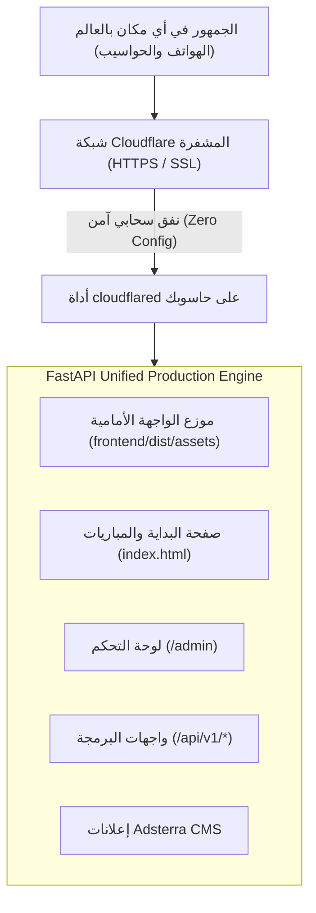

# وثيقة تصميم: استضافة الموقع مجاناً وربطه بنطاق مجاني (Free Hosting & Free Domain Setup)

## 1. الهدف والملخص (Goal & Scope)
تمكين المستخدم من إطلاق منصة كرة القدم الحية للجمهور عالمياً من حاسوبه الشخصي **مجاناً 100% دون دفع أي سنت أو استخدام بطاقات بنكية**، عبر:
1. توحيد خادم الإنتاج ليعمل الموقع بالكامل (الواجهة الأمامية + لوحة التحكم + الباك إند API) على منفذ واحد فقط (`http://127.0.0.1:8000`).
2. إتاحة الموقع للإنترنت العام عبر نفق سحابي عالمي مشفر بـ HTTPS (Cloudflare Quick Tunnel) بدومين عالمي فوري مجاني.
3. دعم ربط نطاق مجاني دائم ومخصص عبر **DuckDNS** (`*.duckdns.org`) مع أداة تحديث تلقائي للـ IP.
4. التأكد من عمل إعلانات Adsterra وتحليلات الزوار عبر الرابط العام دون أي مشاكل CORS.

---

## 2. المعمارية الفنية (Technical Architecture)



---

## 3. خطة التنفيذ الممنهجة (Implementation Steps)

### أ. توحيد السيرفر (Unified Production Server) في `app.py`
- بدلاً من تشغيل خادمين منفصلين (Vite على 5173 وبايثون على 8000):
- فحص وجود مجلد `frontend/dist`.
- ربط المجلد عبر `StaticFiles(directory="frontend/dist/assets")` لخدمة ملفات CSS و JS والأيقونات بسرعة فائقة.
- إرجاع `index.html` عند طلب الصفحة الرئيسية `/` وأي مسارات واجهة مثل `/admin` مع تمرير ترويسات الأمان والكاش.
- النتيجة: يعمل الموقع كاملاً بضغطة زر واحدة على المنفذ `8000` دون الحاجة لأي خادم تطوير.

### ب. تشغيل النفق السحابي المجاني (Cloudflare Quick Tunnel)
- تنزيل أداة `cloudflared.exe` الرسمية الآمنة لمرة واحدة.
- تشغيل أمر النفق المباشر:
  ```bash
  cloudflared tunnel --url http://127.0.0.1:8000
  ```
- استخراج الرابط العالمي الفوري (مثل `https://xxxx.trycloudflare.com`).
- هذا الرابط يعمل فوراً على أي هاتف متصل بالإنترنت من أي شبكة خلوية في العالم مع شهادة SSL خضراء مجانية وبدون فتح أي بورت في الراوتر.

### ج. أداة الربط المجاني الدائم (DuckDNS Automation)
- توفير سكربت اختياري خفيف `scripts/duckdns_sync.py`:
- يقوم بتحديث عنوان الـ IP لحسابك في DuckDNS تلقائياً حتى يظل نطاقك الخاص (مثل `koralive.duckdns.org`) متصلاً دائماً بجهازك حتى لو تغيّر الـ IP المنزلي.

---

## 4. معايير القبول والتحقق (Acceptance Criteria)
1. تشغيل `http://127.0.0.1:8000` بمفرده في المتصفح يفتح موقع كورة لايف كامل مع الواجهة والنتائج والإعلانات.
2. الانتقال إلى `http://127.0.0.1:8000/admin` يفتح لوحة التحكم فوراً.
3. تشغيل أداة النفق يولد رابط HTTPS عام يمكن فتحه من الهاتف المحمول وشبكة 4G/5G وتصفح الموقع بسلاسة.
4. نجاح كافة اختبارات النظام (124 Pytest و 41 Vitest و 48 Live Tests) بنسبة 100%.
