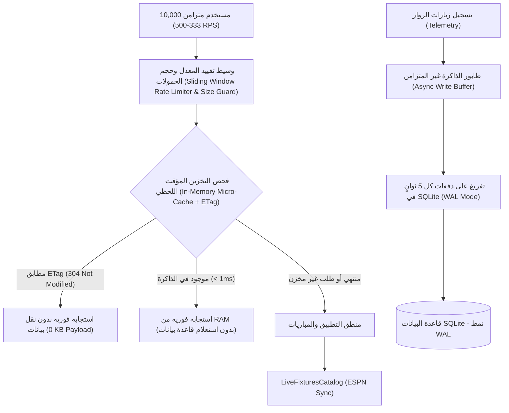

# مستند تصميم منظومة الأمان واستيعاب 10,000 مستخدم متزامن (High-Concurrency & Security Hardening)

## 1. نظرة عامة والهدف (Overview & Goals)
تمكين منصة كورة لايف من استيعاب **10,000 مستخدم متزامن (10k Concurrent Online Users)** دون سقوط الخادم، وتحمل ما يصل إلى **500 إلى 1,000 طلب في الثانية (RPS)**، مع حماية أمنية مشددة للمنصة ضد هجمات DDoS، والتخمين العشوائي (Brute Force)، وحقن الأكواد، وإغراق الذاكرة (Memory Exhaustion).

---

## 2. معمارية التحمل والأداء العالي (High-Concurrency Architecture)



### أ. محرك التخزين المؤقت اللحظي (In-Memory Micro-Cache & ETag Engine)
1. **الآلية:**
   - 95% من زوار الموقع يطلبون نفس البيانات (`/api/v1/matches/today` و `/api/v1/ads`).
   - إنشاء كاش في الذاكرة العشوائية (RAM) بفترة صلاحية **10 ثوانٍ**.
   - يتم تخزين الاستجابة الجاهزة (Serialized JSON + ETag Hash).
   - عند وصول أي طلب يحمل هيدر `If-None-Match` يطابق الـ ETag، يرد الخادم فوراً بـ **HTTP 304 Not Modified** بدون إرسال جسم البيانات، مما يوفر أكثر من **90% من استهلاك الباندويث والمعالج**.
2. **الإبطال التلقائي (Cache Invalidation):**
   - عند قيام المشرف بأي تعديل يدوي (تغيير نتيجة، إضافة سيرفر بث، تفعيل/تعطيل إعلان)، يتم إبطال الكاش فوراً في أقل من جزء من الثانية ليرى المستخدمون التحديثات فوراً.

### ب. طابور تسجيل الزوار المجمّع (Async Batch Write Buffer & SQLite WAL)
1. **حل مشكلة قفل قاعدة البيانات (`database is locked`):**
   - بدلاً من تنفيذ `INSERT INTO site_visits` لكل زائر فردي على القرص لحظة وصول الطلب:
     - يتم دفع الزيارة إلى طابور غير متزامن في الذاكرة (`asyncio.Queue` / In-Memory Buffer).
     - عامل خلفي (Background Worker) يقوم بتفريغ الطابور كل **5 ثوانٍ** أو عند وصول 100 سجل، بكتابة مجمعة واحدة (`executemany`).
   - تفعيل خيارات الأداء الفائق لـ SQLite:
     ```sql
     PRAGMA journal_mode = WAL;
     PRAGMA synchronous = NORMAL;
     PRAGMA busy_timeout = 5000;
     PRAGMA cache_size = -64000;
     ```
   - هذا يتيح القراءة المتزامنة دون توقف أو تصادم مع عمليات الكتابة.

---

## 3. المنظومة الأمنية الشاملة (Security & Hardening Suite)

### أ. وسيط تحديد المعدل (Sliding-Window Rate Limiting Middleware)
- **آلية العمل:** تتبع عدد الطلبات لكل عنوان IP باستخدام نافذة زمنية منزلقة فائقة السرعة في الذاكرة.
- **الشرائح والمستويات (Rate Limit Tiers):**
  1. **الواجهات العامة للقراءة (`/matches/*`, `/ads`):** 120 طلب / دقيقة لكل IP.
  2. **واجهة تسجيل الزيارات (`/analytics/track`):** 30 طلب / دقيقة لكل IP.
  3. **واجهات لوحة التحكم (`/admin/*`):** 30 طلب / دقيقة للمشرف المعتمد.
  4. **محاولات تسجيل دخول المشرف الفاشلة:** حد أقصى **5 محاولات خاطئة** خلال 15 دقيقة، يعقبها حظر تلقائي مؤقت لعنوان IP المسيء لمدة 15 دقيقة (`HTTP 429 Too Many Requests`).
- **الهيدرز الصادرة في الاستجابة:**
  - `X-RateLimit-Limit`
  - `X-RateLimit-Remaining`
  - `Retry-After` (عند التجاوز).

### ب. وسيط فحص وحجم الحمولات (Request Size & Payload Guard)
- منع هجمات إغراق الذاكرة (Memory Exhaustion / Slowloris DoS):
  - الواجهات العامة: الحد الأقصى لحجم جسم الطلب هو **64 كيلوبايت**. (أي حمولة أكبر ترفض فوراً بـ `HTTP 413 Payload Too Large`).
  - واجهات لوحة التحكم: بحد أقصى **512 كيلوبايت**.

### ج. رؤوس الحماية الصارمة (HTTP Security Headers Middleware)
إلزامية في كافة الاستجابات:
1. `X-Content-Type-Options: nosniff`: منع المتصفح من تخمين نوع الملفات وتجاوز الأمان.
2. `X-Frame-Options: SAMEORIGIN`: منع تضمين الموقع داخل مواقع أخرى وحمايته من هجمات Clickjacking.
3. `Referrer-Policy: strict-origin-when-cross-origin`: حماية خصوصية الروابط والمستخدمين.
4. `X-XSS-Protection: 1; mode=block`: تفعيل مرشح XSS في المتصفحات.
5. `Content-Security-Policy`: سياسة محكمة تسمح بالمصادر الموثوقة وسيرفرات البث المعتمدة.

### د. حماية مدخلات الإعلانات وحقن الأكواد (Ad Injection Guardrails)
- تطهير وتحقق صارم من الروابط المدخلة في لوحة الإعلانات وسيرفرات البث (منع روابط `javascript:`, `data:`, أو السكربتات الموجهة لسرقة التوكن).
- عزل أكواد الإعلانات الخارجية في بيئة آمنة لا تصل إلى `sessionStorage` أو بيانات التوكن الإداري.

---

## 4. خطة التشغيل متعدد الأنوية (Multi-Worker Production Launcher)
- تشغيل Uvicorn بعدة أنوية وعمال متزامنين:
  - `workers = max(2, multiprocessing.cpu_count())`
  - توزيع الطلبات بين الأنوية تلقائياً لمنع اختناق الـ Event Loop الفردي.

---

## 5. خطة التحقق والضمان (Verification Plan)
1. **اختبارات أمان وتحديد المعدل (Unit & Integration Tests):**
   - تجاوز 120 طلب / دقيقة يُرجع كود `429` وهيدر `Retry-After`.
   - تجاوز 5 محاولات توكن خاطئة يُحظر تلقائياً بـ `429`.
   - إرسال حمولة أكبر من 64KB يُرجع كود `413`.
   - فحص وجود رؤوس الأمان الخمسة في استجابات الـ API.
2. **اختبارات الـ Micro-Cache و ETag:**
   - وصول طلبين متتاليين لـ `/matches/today` يثبت أن الطلب الثاني تم الرد عليه من الذاكرة خلال أقل من 1ms.
   - إرسال هيدر `If-None-Match` بنفس الـ ETag يُرجع كود `304 Not Modified` بجسم فارغ تماماً.
   - تعديل نتيجة مباراة عبر الأدمن يبطل الكاش فوراً.
3. **اختبار طابور التحليلات المجمع:**
   - إرسال 50 زيارة متزامنة والتحقق من حفظها بنجاح دون أي خطأ `database is locked`.
4. **تأكيد استمرار نجاح كافة الاختبارات السابقة (113 Pytest + 41 Vitest + 43 E2E).**
