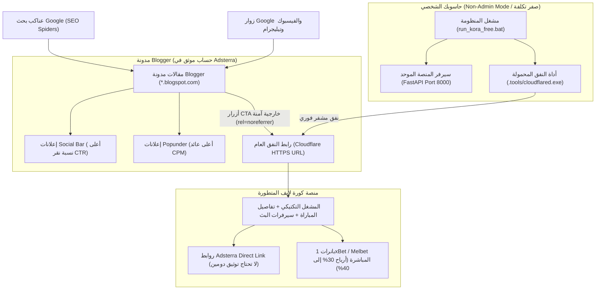

# وثيقة تصميم نهائية: المنظومة الهجينة (Blogger SEO + Cloudflare Tunnel + Adsterra Monetization)

- **التاريخ:** 24 نوفمبر 2026
- **الحالة:** معتمدة للبدء في خطة التنفيذ (Approved Design)
- **المشروع المستهدف:** `football-live-score-platform`
- **المسار:** `docs/superpowers/specs/2026-11-24-blogger-hybrid-seo-monetization-design.md`

---

## 1. الأهداف والنية (Intent & Why)

### 1.1 الهدف الأساسي (Core Goal)
بناء منظومة مجانية متكاملة 100% (تكلفة \$0) لإطلاق وتشغيل منصة كرة القدم الحية وربطها بمدونة **Blogger**، لتحقيق:
1. **جلب زيارات مستمرة وضخمة من محركات بحث Google (SEO)** عبر مقالات وتغطيات المباريات على نطاق Blogger المجاني (`*.blogspot.com`).
2. **تشغيل المنصة الحية بكامل ميزاتها** (النتائج الفورية، المشغل التكتيكي، البث المباشر متعدد السيرفرات) وإتاحتها للجمهور عبر نفق مشفر (Cloudflare Quick Tunnel) دون الحاجة لأي صلاحيات مسؤول (Admin/UAC Rights) على حاسوب المستخدم.
3. **تحقيق أقصى عائد إعلاني مجرب** بالجمع بين إعلانات **Adsterra** المعتمدة على Blogger، وإعلانات **Direct Link** وعروض **التسويق بالعمولة (1xBet / Melbet)** داخل المنصة الحية، لإعادة استثمار الأرباح لاحقاً في نطاق وسيرفر مدفوعين.
4. **الحماية التامة من إغلاق المدونة (DMCA Immunity):** عزل مشغلات وسيرفرات البث خارج Blogger واستخدام أزرار توجيه خارجية آمنة (`rel="noreferrer"`).

---

## 2. دراسة الخيارات والقرارات المعمارية (Approaches & Key Decisions)

### 2.1 الخيارات المدروسة
1. **الخيار 1 (المعتمد): المنظومة الهجينة الآمنة (Blogger كبوابة SEO + نفق مشفر للمنصة + Adsterra)**:
   - مقالات Blogger تستهدف الكلمات المفتاحية لمباريات اليوم.
   - الزوار ينتقلون عبر زر تفاعلي عريض ومباشر ("⚡ الانتقال إلى البث المباشر والتشكيلة الحية") للمنصة.
   - إعلانات Adsterra تعمل بكامل طاقتها على دومين Blogspot المعتمد، والمنصة تعمل بنظام Direct Links والبانرات.
2. **الخيار 2 (مستبعد): استضافة Vercel + Render المجانية**:
   - تم استبعاده لأن Adsterra ترفض توثيق نطاقات `*.vercel.app` البرمجية، بالإضافة إلى دخول سيرفر Render المجاني في وضع السكون بعد 15 دقيقة مما يقطع البث والنتائج.
3. **الخيار 3 (مستبعد): تضمين البث عبر Iframe داخل Blogger**:
   - تم استبعاده لتفادي إغلاق مدونة Blogger وحساب Google نتيجة إشعارات حقوق البث التلفزيوني (DMCA).

---

## 3. المعمارية الفنية المتكاملة (Technical Architecture)

---

## 4. المكونات التنفيذية الأربعة (Implementation Deliverables)

### 4.1 مشغل النفق والسيرفر المحمول الخالي من قيود المسؤول (`run_kora_free.bat`)
- تشغيل خادم FastAPI الموحد في الخلفية على المنفذ `8000`.
- إطلاق أداة `.tools\cloudflared.exe` كـ Process مستخدم عادي بدون أي طلبات UAC أو صلاحيات Administrator.
- قراءة الرابط العام فوري التشفير (`https://xxxx.trycloudflare.com`).
- نسخ الرابط تلقائياً إلى حافظة ويندوز (`clip`) وحفظه في ملف `data/tunnel_url.txt` مع رسالة واضحة للمستخدم.

### 4.2 حزمة نشر المقالات الرياضية المتصدرة لـ SEO (Blogger Article Kit)
- قالب مقال عربي احترافي جاهز للنسخ المباشر يتضمن:
  - كود Schema.org بصيغة JSON-LD لحدث المباراة (`SportsEvent`) لظهور النتيجة في نتائج Google الأولى.
  - جدول تفاصيل المباراة (البطولة، القناة الناقلة، المعلق، توقيت مكة والقاهرة، الملعب).
  - زر تفاعلي رئيسي (Hero CTA Button) بستايل عصري متجاوب ينقل الزائر للرابط المباشر.
  - وسم حماية المصدر: `target="_blank" rel="noopener noreferrer"` لعزل Blogger تماماً عن جهة البث.

### 4.3 مولد المقالات السريع بنقرة زر واحدة داخل لوحة التحكم (Admin 1-Click SEO Generator)
- إضافة زر **"نسخ مقال التدوينة 📝"** بجانب كل مباراة في لوحة التحكم (`/admin`):
  - يقوم تلقائياً بدمج أسماء الفريقين والشعار والتوقيت والقنوات في كود المقال الجاهز للنشر.
  - نسخه للحافظة بضغطة زر واحدة ليلصقه المستخدم مباشرة في محرر Blogger دون كتابة يدوية.

### 4.4 خطة الربح الإعلاني (Adsterra & Affiliates Execution Plan)
1. **توثيق مدونة Blogger في Adsterra:**
   - إضافة رابط `yourname.blogspot.com` في لوحة Adsterra Publisher (قبول فوري خلال 5-10 دقائق).
   - تركيب كود **Social Bar** داخل وسم `<head>` في قالب Blogger.
   - تركيب كود **Popunder** قبل إغلاق `</body>`.
2. **استثمار المنصة الحية (بدون الحاجة لتوثيق دومين النفق):**
   - إنشاء **Direct Link** من لوحة Adsterra وربطه بأزرار المشغل أو زر التحويل.
   - رفع بانرات شركاء المراهنات الرياضية (1xBet / Melbet / Bet365) في مواضع `header_top` و `player_bottom` عبر تبويب "إدارة الإعلانات" المدمج في المنصة.

---

## 5. مصفوفة التحقق والاختبار (Verification Strategy)
1. **فحص تشغيل المشغل بدون صلاحيات أدمن:** التأكد من إقلاع السيرفر والنفق وظهور الرابط دون أي رسائل تنبيهية من نظام ويندوز.
2. **فحص الاتصال الخارجي:** فتح رابط النفق المتولد من متصفح هاتف خارجي والتحقق من عمل البث والنتائج والواجهة العربية RTL.
3. **فحص أزرار التوجيه (CTA Flow):** نشر تجربة مقال على Blogger والتأكد من انتقال الزائر بسلاسة إلى صفحة المباراة الحية دون أي تحذيرات أمان.
4. **فحص احتساب الأرباح والنقرات:** التأكد من توجيه روابط Direct Link والبانرات إلى صفحات الإعلانات بشكل سليم.
