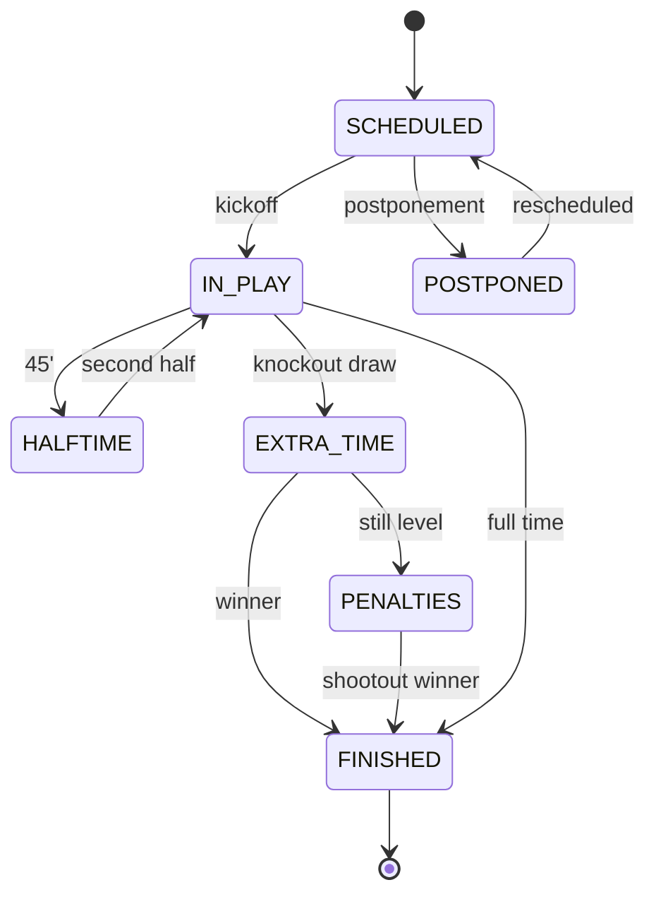
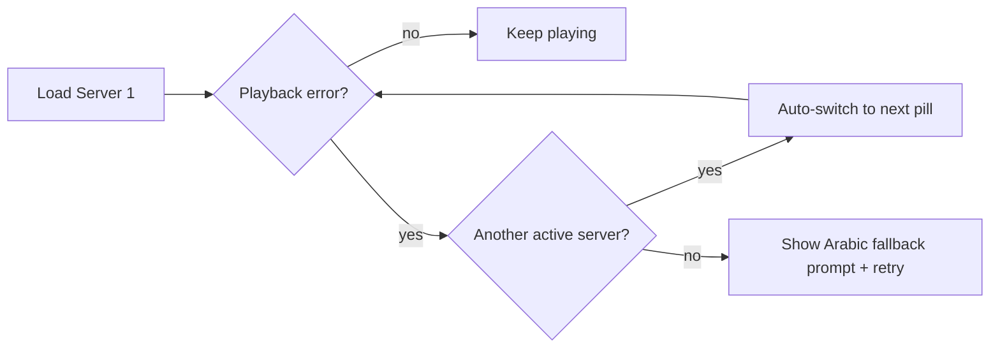
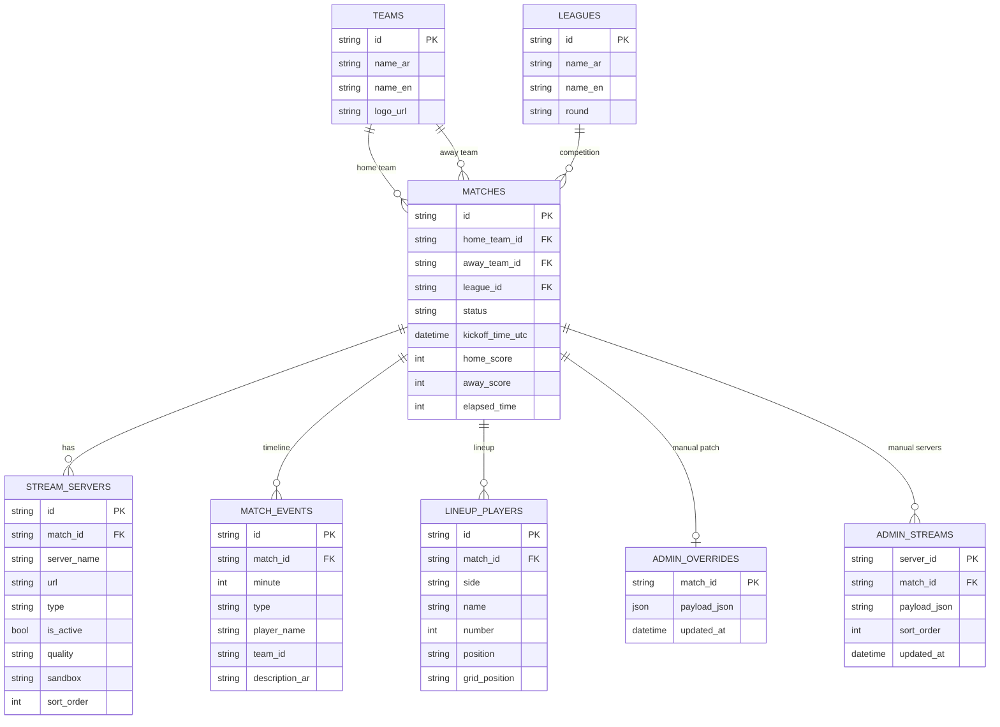

# Product Requirements Document (PRD): Arabic Football Live Score & Streaming Platform

**Version:** 1.0.0  
**Date:** 2026-11-18  
**Status:** Approved for build  
**Owners:** Product / Backend / Frontend  
**Spec source:** `docs/superpowers/specs/2026-11-18-football-live-score-platform-design.md`  
**Implementation plan:** `docs/superpowers/plans/2026-11-18-football-live-score-platform.md`

---

## 1. Executive Summary

A fast, RTL-first Arabic football portal that combines:

1. **KoraCity-style daily schedule cards** (Option A) with live scores, countdowns, and competition subtitles.
2. **A hybrid match center** that places a multi-server live stream player above a tabbed tactical zone (timeline, pitch lineups, stats, standings).
3. **A resilient 3-tier data engine** with a strict precedence rule:
   `Admin Override > Sports API / Open Backend > Scraper Ingestion`.
4. **An admin CMS API** for emergency score/status overrides and instant stream-server swaps.

The platform never proxies video. Streams are embedded client-side using sandboxed iframes or direct HLS playback, keeping bandwidth and legal exposure low.

---

## 2. Goals and Non-Goals

### 2.1 Goals

- Deliver a familiar Arabic matchday experience with correct RTL layout at every breakpoint.
- Keep the match card readable in three states: live, upcoming, finished (plus postponed).
- Make stream failover a one-click operation for users and a one-request operation for admins.
- Guarantee that an admin's emergency score, status, or stream change is never overwritten by an automated sync.
- Keep kickoff times unambiguous by storing UTC and rendering the user's configured timezone (default `Asia/Riyadh`).
- Ship a design-token contract that Figma and Tailwind can both consume.

### 2.2 Non-Goals

- Hosting or transcoding video.
- Betting, gambling, or wagering features.
- Social feeds, comments, forums, or user-generated content.
- Native mobile apps (responsive mobile web + PWA banner only).
- Automated payment or subscription flows.

### 2.3 Success Metrics

| Metric | Target |
|---|---|
| Schedule API p95 latency (cached fixtures) | < 150 ms |
| Match detail p95 latency | < 250 ms |
| Client stream failover to next server | < 2 s after error |
| Admin override reflected on public API | < 1 request cycle (immediate) |
| Match card CLS on mobile | < 0.05 |
| Lighthouse accessibility (home + detail) | ≥ 95 |

---

## 3. Personas and Jobs To Be Done

| Persona | Context | Job |
|---|---|---|
| **Youssef, casual fan (mobile)** | Opens the site 10 minutes before kickoff | "Show me today's matches and which channel has the game." |
| **Salma, cord-cutter (desktop)** | Watches on a second screen | "Give me a working stream and a clean stats view." |
| **Karim, editor/admin** | Managing a busy matchday | "Fix a broken stream or wrong score in under 30 seconds." |
| **Data operator** | Monitors ingestion | "See unmatched Arabic team names without breaking the feed." |

---

## 4. Scope and Screens

### 4.1 Screen 1 — Home Match Schedule (Option A, RTL)

- Header: dark/light toggle, navigation (`الرئيسية`, `مباريات اليوم`, `مباريات الغد`, `نتائج أمس`), timezone label (`بتوقيت مكة المكرمة`).
- Date pills: `مباريات الأمس`, `مباريات اليوم`, `مباريات الغد`.
- Match card layout:
  - **Inline-start (right in RTL):** home crest + Arabic club name.
  - **Center:** live score + pulsing red badge `مباشر الآن (68')`, or kickoff time + green countdown `تبدأ بعد: 03:15:20`, or full-time score + neutral `انتهت`.
  - **Inline-end (left in RTL):** away crest + Arabic club name.
  - **Subtitle:** `الدوري الإسباني • الجولة 12`.
- Selecting a card opens the hybrid match center.

### 4.2 Screen 2 — Hybrid Match Center

- **Top zone:** score header, live clock/event ticker, stream player, server pills, broadcast metadata (channel, commentator, stadium, referee).
- **Bottom zone tabs:**
  1. `الملخص` — minute-by-minute timeline with goal, card, substitution, and VAR icons.
  2. `التشكيلة` — green pitch with formation rows and **Latin/English player names (Option B)**.
  3. `الإحصائيات` — comparative bars (possession, shots, shots on target, corners, fouls, offsides).
  4. `الترتيب` — league table with home/away rows highlighted.

### 4.3 Screen 3 — Admin CMS

- Operational match table for today.
- Per match: stream servers array, active toggle, quality, manual score/status override, channel/commentator overrides.
- Unassigned stream tray: future hook for linking scraped streams to API fixtures.

---

## 5. Data Contracts

All timestamps are stored as timezone-aware UTC `datetime` values. Arabic display strings are stored separately from English/Latin canonical names. IDs are strings.

### 5.1 Team

| Field | Type | Required | Notes |
|---|---|---|---|
| `id` | string | no | Stable provider or internal ID. |
| `name_ar` | string | yes | Arabic display name, e.g. `ريال مدريد`. |
| `name_en` | string | no | Canonical Latin name, e.g. `Real Madrid`. |
| `logo_url` | string | no | Crest URL; `null` renders an initials fallback. |

### 5.2 League

| Field | Type | Required | Notes |
|---|---|---|---|
| `id` | string | no | Competition ID. |
| `name_ar` | string | yes | e.g. `دوري أبطال أوروبا`. |
| `name_en` | string | no | e.g. `UEFA Champions League`. |
| `round` | string | no | e.g. `الجولة 5`. |
| `logo_url` | string | no | Competition badge. |

### 5.3 StreamServer

| Field | Type | Required | Notes |
|---|---|---|---|
| `id` | string | yes (response) | Stable server key. |
| `server_name` | string | yes | e.g. `سيرفر 1 - متعدد الجودات`. |
| `url` | string | yes | Absolute `http(s)` URL; no internal proxy. |
| `type` | `"iframe"` \| `"m3u8"` | yes | Determines player element. |
| `is_active` | boolean | yes | Inactive pills are hidden or disabled. |
| `quality` | string | no | `multiquality`, `hd`, `sd`, `youtube`. |
| `sandbox` | string | no | Iframe sandbox tokens; default `allow-scripts allow-same-origin allow-presentation`. |

### 5.4 MatchEvent

| Field | Type | Required | Notes |
|---|---|---|---|
| `id` | string | no | Event key. |
| `minute` | integer | yes | Match minute. |
| `type` | string | yes | `goal`, `yellow_card`, `red_card`, `substitution`, `var`. |
| `player_name` | string | yes | Latin name for consistency with the pitch. |
| `team_id` | string | no | Team reference. |
| `description_ar` | string | no | Arabic timeline sentence. |

### 5.5 LineupPlayer

| Field | Type | Required | Notes |
|---|---|---|---|
| `name` | string | yes | **Latin/English only (Option B)**. |
| `number` | integer | yes | Jersey number. |
| `position` | string | yes | `GK`, `DF`, `MF`, `FW`. |
| `is_starter` | boolean | yes | Starter vs bench. |
| `grid_position` | string | no | `row:column`, e.g. `3:2`. |

### 5.6 Match

| Field | Type | Required | Notes |
|---|---|---|---|
| `id` | string | yes | Match key. |
| `home_team` / `away_team` | Team | yes | Home renders inline-start. |
| `league` | League | yes | Competition + round. |
| `status` | MatchStatus | yes | See lifecycle. |
| `kickoff_time` | datetime (UTC) | yes | Source of truth for display time. |
| `home_score` / `away_score` | integer | yes | Defaults to 0 before kickoff. |
| `elapsed_time` | integer | no | Live minute. |
| `stream_servers` | StreamServer[] | yes | Ordered by failover priority. |
| `channel` | string | no | e.g. `beIN Sports 1`. |
| `commentator` | string | no | e.g. `عصام الشوالي`. |
| `stadium` | string | no | Broadcast metadata. |
| `referee` | string | no | Broadcast metadata. |
| `is_admin_override` | boolean | yes | True when an admin override is active. |

### 5.7 MatchDetail

`MatchDetail` wraps a `Match` with `home_lineup`, `away_lineup`, `events`, `stats`, and `standings`.

`stats` is a keyed object in the domain model and is serialized by the API as an ordered list:

```json
[
  {"key": "possession", "label_ar": "الاستحواذ", "home": 58, "away": 42, "unit": "%"}
]
```

### 5.8 AdminOverride

A partial patch with any of: `home_score`, `away_score`, `status`, `elapsed_time`, `channel`, `commentator`, `stadium`, `referee`. At least one field is required. Scores are `0..99`, elapsed time is `0..130`.

---

## 6. Match Lifecycle



| State | Arabic badge | Card center | `is_live` |
|---|---|---|---|
| `SCHEDULED` | `لم تبدأ` | Kickoff time + green countdown | false |
| `IN_PLAY` | `مباشر الآن` | Score + pulsing red badge + minute | true |
| `HALFTIME` | `استراحة` | Score + halftime badge | true |
| `EXTRA_TIME` | `مباشر الآن` | Score + minute (e.g. `105'`) | true |
| `PENALTIES` | `مباشر الآن` | Score + `ركلات الترجيح` | true |
| `FINISHED` | `انتهت` | Full-time score + neutral badge | false |
| `POSTPONED` | `مؤجلة` | Neutral notice | false |

**Transition rules**

- The UI must swap the green countdown for the red live badge without a page reload when the status changes.
- A manual admin status always wins, including a transition back to `FINISHED` or `POSTPONED`.
- `elapsed_time` is ignored for non-live states.

---

## 7. Ingestion Priority and Admin Override Rules

### 7.1 Priority ladder

1. **Admin Override** — highest. Applied on every read after the base fixture is loaded.
2. **Sports API / Open Backend** — `rezarahiminia/livescoreFootball` or equivalent. Authoritative for fixtures, scores, lineups, stats.
3. **Scraper Ingestion** — stream embeds, Arabic commentary metadata, regional league supplements.

### 7.2 Admin Override persistence

- Overrides are persisted in SQLite (`admin_overrides`) as a JSON payload with `updated_at`.
- The public read path reloads the override **after** the base fixture and applies it last.
- An automated API or Scraper sync may update the base fixture freely; it cannot erase the override row.
- Clearing an override is an explicit admin action. The base values become visible again on the next request.
- Admin stream rows (`admin_streams`) are prepended to the stream list; base/scraped streams remain as fallbacks.

### 7.3 Team alias mapping

- Arabic names are normalized (tashkeel removed, alef/yaa normalized, `نادي`/`فريق` prefixes stripped).
- Known aliases map to canonical English names (`تشيلسي` → `Chelsea`).
- Unknown names must **not** break ingestion: they remain as-is and are surfaced for the future Unassigned Tray.

---

## 8. Stream Failover and Player Security

### 8.1 Client behavior



- Player tries the first active server in order.
- On `error`/timeout, it auto-advances to the next active server and highlights that pill.
- If all servers fail, it shows `تعذر تشغيل البث. جرّب سيرفراً آخر أو أعد المحاولة.` with a retry button.
- A user click on any pill switches immediately and resets the failover cursor.

### 8.2 Security and compliance

- Iframes use `sandbox="allow-scripts allow-same-origin allow-presentation"` and `referrerPolicy="no-referrer"`.
- `iframe` and `m3u8` URLs must be absolute `http(s)`; `javascript:` and relative proxy URLs are rejected by the API.
- No backend video proxying, no stream URL rewriting, no token injection.
- Admin endpoints require `X-Admin-Token` and use constant-time comparison.

---

## 9. Timezone Rules

- All stored kickoff times are UTC.
- The API accepts `?tz=<IANA name>` on `/api/v1/matches/today`; default is `Asia/Riyadh`.
- The response includes `timezone`, `timezone_label_ar`, `kickoff_time_utc`, `kickoff_time_local`, and `kickoff_date_local`.
- The default label is `بتوقيت مكة المكرمة`; `Africa/Casablanca` maps to `بتوقيت المغرب`.
- Date filtering uses the **local** calendar date, not UTC.
- An unknown timezone returns HTTP 400.
- The UI never performs its own timezone math when API-local fields are present.

| Input UTC | Riyadh local (+03:00) | Card shows |
|---|---|---|
| `2026-11-18T16:00:00Z` | `2026-11-18 19:00` | `19:00` |
| `2026-11-18T21:30:00Z` | `2026-11-19 00:30` | `00:30` and belongs to the **next** local date |

---

## 10. API Contract

Base path: `/api/v1`. JSON uses snake_case. Admin routes require `X-Admin-Token`.

### 10.1 `GET /api/v1/matches/today`

Query: `date=YYYY-MM-DD` (optional), `tz=Asia/Riyadh` (optional).

```json
{
  "date": "2026-11-18",
  "timezone": "Asia/Riyadh",
  "timezone_label_ar": "بتوقيت مكة المكرمة",
  "matches": [
    {
      "id": "match_clasico",
      "home_team": {"id": "real_madrid", "name_ar": "ريال مدريد", "name_en": "Real Madrid", "logo_url": null},
      "away_team": {"id": "barcelona", "name_ar": "برشلونة", "name_en": "Barcelona", "logo_url": null},
      "league": {"id": "la_liga", "name_ar": "الدوري الإسباني", "name_en": "La Liga", "round": "الجولة 12", "logo_url": null},
      "status": "IN_PLAY",
      "status_label_ar": "مباشر الآن",
      "kickoff_time_utc": "2026-11-18T14:52:00Z",
      "kickoff_time_local": "17:52",
      "kickoff_date_local": "2026-11-18",
      "home_score": 2,
      "away_score": 1,
      "elapsed_time": 68,
      "live_minute_label": "68'",
      "countdown_seconds": null,
      "competition_subtitle": "الدوري الإسباني • الجولة 12",
      "is_admin_override": false,
      "channel": "beIN Sports 1",
      "commentator": "عصام الشوالي",
      "stadium": "سانتياغو برنابيو",
      "referee": "ماتيو لاهوز"
    }
  ]
}
```

`countdown_seconds` is populated only for `SCHEDULED`; it is `null` for live, finished, and postponed matches.

### 10.2 `GET /api/v1/matches/{match_id}`

Returns the hybrid match-center payload:

```json
{
  "match": {"...": "MatchCard fields"},
  "servers": [
    {
      "id": "srv_demo_1",
      "server_name": "سيرفر 1 - متعدد الجودات",
      "url": "https://live.example/embed/clasico/multi",
      "type": "iframe",
      "is_active": true,
      "quality": "multiquality",
      "sandbox": "allow-scripts allow-same-origin allow-presentation"
    }
  ],
  "home_lineup": [{"name": "Thibaut Courtois", "number": 1, "position": "GK", "grid_position": "1:1"}],
  "away_lineup": [{"name": "Robert Lewandowski", "number": 9, "position": "FW", "grid_position": "5:2"}],
  "events": [{"minute": 12, "type": "goal", "player_name": "Kylian Mbappe", "team_id": "real_madrid", "description_ar": "هدف افتتاحي"}],
  "stats": [{"key": "possession", "label_ar": "الاستحواذ", "home": 58, "away": 42, "unit": "%"}],
  "standings": [{"position": 1, "team_name_ar": "ريال مدريد", "played": 12, "points": 31, "is_home": true}]
}
```

`404` when the match ID is unknown.

### 10.3 `POST /api/v1/admin/matches/{match_id}/streams`

Adds or edits a server. Editing is matched by `id` or by normalized URL. The touched server moves to the front of the list.

```json
{
  "server_name": "سيرفر 3 - احتياطي",
  "url": "https://backup.example/embed/3",
  "type": "iframe",
  "is_active": true,
  "quality": "hd"
}
```

Response `201`:

```json
{"match_id": "match_clasico", "servers": [{"...": "ordered server list"}]}
```

Validation: `422` for non-http(s) URLs or unsupported `type`; `404` for unknown matches; `401` without a valid token.

### 10.4 `DELETE /api/v1/admin/matches/{match_id}/streams/{server_id}`

Deletes an admin-managed server. Response `200` with the remaining server list; `404` if the server does not exist.

### 10.5 `POST /api/v1/admin/matches/{match_id}/override`

```json
{
  "home_score": 3,
  "away_score": 0,
  "status": "FINISHED",
  "elapsed_time": 90,
  "commentator": "معلق احتياطي"
}
```

Response `200` with the resolved `MatchCard` and `is_admin_override: true`. At least one field is required; invalid values return `422`.

### 10.6 `DELETE /api/v1/admin/matches/{match_id}/override`

Clears the override. Response `200` with the base API values and `is_admin_override: false`.

### 10.7 `GET /health`

```json
{"status": "ok", "matches": 4, "timezone": "Asia/Riyadh"}
```

---

## 11. Database and ERD

Production can use PostgreSQL; the reference implementation uses SQLite for zero-ops deployments and tests.



**Storage rules**

- `admin_overrides` is the durable source of manual match patches.
- `admin_streams` is the durable source of admin-added servers; the base fixture keeps its own server list as fallback.
- Scraped/API fixtures can be cached separately; deleting the cache must never delete admin rows.

---

## 12. RTL, Design System, and Accessibility

- `dir="rtl"`, `lang="ar"` at the document root.
- Use CSS logical properties (`margin-inline-start`, `padding-inline-end`, `inset-inline-start`) — no hard-coded left/right for team alignment.
- Home team is always inline-start; away team is always inline-end, on mobile and desktop.
- Latin player names on the pitch are explicitly isolated with `dir="ltr"` and centered.
- Number formatting uses Latin digits for scores and minutes for scanability.
- Color is never the only state signal: live has a pulse + label, finished has a label, postponed has a label.
- Focus rings are visible on all pills, tabs, and cards; keyboard activation works with `Enter`/`Space`.
- Tap targets are at least 44×44 px on mobile.
- The live pulse respects `prefers-reduced-motion` and becomes a static dot.
- Token contract: `design/tokens.json` (`live-red #dc2626`, `countdown-green #16a34a`, `pitch-green #15803d`, dark/light neutrals, 4px spacing scale, Cairo/Inter typography).

---

## 13. Non-Functional Requirements

| Area | Requirement |
|---|---|
| Performance | Schedule p95 < 150 ms from cache; detail p95 < 250 ms; no layout shift on card state changes. |
| Availability | Read path stays up if the upstream API or scraper is down; demo/cached fixtures are served. |
| Scalability | Stateless API workers; SQLite for single-node, PostgreSQL for horizontal scale. |
| Security | Admin token required for writes; constant-time comparison; URL scheme validation; iframe sandboxing; no secrets in client bundles. |
| Observability | `/health` endpoint; structured ingestion warnings; admin actions identifiable by `updated_at`. |
| Browser support | Last two versions of Chrome, Edge, Firefox, Safari; iOS Safari; Android Chrome. |
| Localization | Arabic UI, RTL layout, English/Latin tactical player names. |

---

## 14. Acceptance Criteria

### Home schedule

- [ ] Cards render home team on the right and away team on the left in RTL.
- [ ] Live cards show a pulsing red `مباشر الآن` badge and the minute.
- [ ] Upcoming cards show a green countdown and kickoff time.
- [ ] Finished cards show `انتهت` and the final score.
- [ ] Postponed cards show `مؤجلة` without a countdown.
- [ ] The competition subtitle includes league and round.
- [ ] Date pills filter by the display timezone (Mecca by default), not the browser timezone.

### Match center

- [ ] The first active stream server loads automatically.
- [ ] Clicking a server pill switches immediately.
- [ ] A failed server auto-advances to the next active server.
- [ ] If all servers fail, an Arabic fallback prompt with retry is shown.
- [ ] The pitch renders 11 players per team with Latin names and jersey numbers.
- [ ] Timeline, lineup, stats, and standings tabs all render real API data.
- [ ] Stat bars compare home and away values with Arabic labels.

### Admin

- [ ] All admin writes reject requests without a valid `X-Admin-Token`.
- [ ] Adding a stream makes it the first fallback on the public detail endpoint.
- [ ] Editing a stream by URL updates instead of duplicating.
- [ ] Deleting an admin stream restores the base stream list.
- [ ] A manual score/status override survives a subsequent API sync and an app restart.
- [ ] Clearing an override restores API values immediately.
- [ ] Invalid scores, statuses, and non-http(s) URLs return `422`.

### Timezone and lifecycle

- [ ] Kickoff times are stored UTC and rendered in `Asia/Riyadh` by default.
- [ ] `kickoff_date_local` drives date filtering across midnight boundaries.
- [ ] A scheduled match becomes live by swapping the countdown for the live badge.
- [ ] An unknown timezone returns `400`.

---

## 15. Test Matrix

| Layer | Test file | Coverage |
|---|---|---|
| Domain + resolver | `tests/live_score/test_resolver.py` | Models, 3-tier precedence, alias normalization, admin stream inheritance. |
| Adapters | `tests/live_score/test_adapters.py` | livescoreFootball mapping, status/lineup/event parsing, stream embed extraction, HLS, dedupe, network failures. |
| API | `tests/live_score/test_api.py` | Option A card contract, lifecycle labels, countdown, timezone, detail payload, admin auth, stream add/edit/delete, override persistence across restart, validation. |
| Design/PRD | `tests/live_score/test_tokens.py` | Token schema, required colors/spacing/logical properties, Arabic/Latin typography, motion/component contracts, PRD required sections and endpoints. |
| Frontend | `frontend/src/components/__tests__/` | MatchCard states, schedule tabs, server switching/failover, hybrid tabs and pitch. |

---

## 16. Operational Runbook

1. Set `LIVE_SCORE_ADMIN_TOKEN` to a strong random value in production.
2. Set `LIVE_SCORE_DB_PATH` to a persistent volume.
3. Optionally set `LIVE_SCORE_API_URL` to the livescoreFootball backend; otherwise demo fixtures are used.
4. Set `LIVE_SCORE_TIMEZONE` (default `Asia/Riyadh`) and `LIVE_SCORE_CORS_ORIGINS`.
5. Start the API: `python run.py` or `uvicorn live_score.api.main:app`.
6. Start the frontend: `cd frontend && npm run dev`.
7. During a matchday: open the admin table, verify streams 30 minutes before kickoff, and override immediately if a link or score is wrong.

---

## 17. Open Questions and Future Work

- Video player library choice (Video.js vs Clappr vs native HLS + hls.js) — current implementation uses native `<video>` for `m3u8` and sandboxed iframes otherwise.
- Cloud hosting target (Vercel + Railway, or VPS/Docker).
- PostgreSQL migration path and read replicas for major matches.
- Unassigned Stream Linking Tray with fuzzy match suggestions.
- Push notifications for kickoff and goals.
- PWA offline schedule caching.
- Automated scraper cadence: 30 minutes before kickoff, then high-frequency during live matches.
